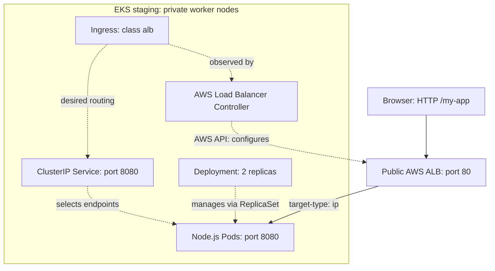

# Node.js DevOps / DevSecOps Challenge

Node.js API deployed to Amazon EKS using GitHub Actions, a private ECR repository, Helm and Argo CD. The staging application is exposed through an AWS Application Load Balancer (ALB).

Based on [EladAviczer/sample-nodejs](https://github.com/EladAviczer/sample-nodejs).

## Repositories and documentation

| Item | Location |
|---|---|
| Application, tests, Dockerfile and CI | [sample-nodejs-app, develop](https://github.com/datik2012-jpg/sample-nodejs-app/tree/develop) |
| Terraform, Argo CD Application and controller configuration | [sample-nodejs-infra, main](https://github.com/datik2012-jpg/sample-nodejs-infra) |
| Helm chart | [helm/sample-nodejs-app](helm/sample-nodejs-app) |
| Architecture diagrams | [docs/ARCHITECTURE.md](docs/ARCHITECTURE.md) |
| Start, pause, verify and troubleshoot staging | [docs/RUNBOOK.md](docs/RUNBOOK.md) |
| Deploy to another Kubernetes cluster or cloud | [docs/PORTABILITY.md](docs/PORTABILITY.md) |
| Submission screenshots | [docs/evidence/README.md](docs/evidence/README.md) |

Use `develop` for the current application implementation. The application repository's `main` branch is not yet a production deployment target.

## Architecture



Solid arrows show application traffic. Dashed arrows show configuration or ownership. In ALB IP mode, traffic goes directly to Pod IPs; it does not pass through the controller or the Service ClusterIP. The Service identifies the application's endpoints.

## CI/CD and Git workflow

1. Develop on `feature/*` branches and open a PR to `develop`.
2. GitHub Actions starts the API, waits for `/ready`, runs automated tests and runs Snyk Code SAST.
3. After those checks succeed, Docker builds the image and Trivy scans it.
4. After merge, a successful push workflow on `develop` publishes `develop-<commit SHA>` to private ECR using AWS OIDC credentials.
5. The workflow creates a separate PR that updates `image.tag` in `values-staging.yaml`.
6. Review that PR and merge it. Argo CD observes `develop`; a manual **Sync** deploys the selected image to staging.

Argo CD auto-sync is not enabled in the current Application manifest. Deployment therefore includes a manual approval through Sync. Bot-created PR workflows can require **Approve and run** in GitHub.

When a push changes **only** `helm/sample-nodejs-app/values-staging.yaml`, CI still builds and scans an image, but skips ECR publishing and the next image-update PR. This prevents a tag-update loop. Other changes, including documentation or chart changes, currently trigger publication after merge to `develop`.

### Versioning

- `feature/*` -> PR -> `develop` is the implemented staging workflow.
- Image tags use the full source commit SHA: `develop-<SHA>`. This identifies the source used for the image.
- The Helm chart has its own semantic version in `Chart.yaml`; `appVersion` is application metadata, not the deployed image selector when `image.tag` is provided.
- Production promotion from `develop` to `main` is not implemented.

### Security gates

| Control | Current behavior |
|---|---|
| SAST | `snyk code test --severity-threshold=high`; reported findings at or above the threshold fail the scan |
| Container vulnerabilities | Trivy scans HIGH and CRITICAL findings with `exit-code: 1` and `ignore-unfixed: false` |
| Publication gate | ECR publication follows successful tests, SAST, image build and Trivy scan |
| Registry | Private Amazon ECR |
| AWS CI authentication | GitHub OIDC and a repository/branch-restricted IAM role; no static AWS access key in the workflow |
| GitHub PR writes | A dedicated job requests `contents: write` and `pull-requests: write` |
| Runtime | Non-root user, privilege escalation disabled, Linux capabilities dropped |
| Controller AWS access | EKS Pod Identity binds the controller ServiceAccount to a separate IAM role |

`SNYK_TOKEN` is configured as a GitHub Actions repository secret. When adapting the project, replace AWS account, role and registry references and configure your own OIDC trust and repository settings. The container scan also examines packaged Node.js dependencies; there is no separate Snyk Open Source dependency job.

## Kubernetes design decisions

**Deployment rather than StatefulSet:** the API has no persistent database, durable local storage or stable per-replica identity. Its Prometheus counters are in memory and reset when a Pod restarts. Replicas are interchangeable.

The chart defines a Deployment, ClusterIP Service and ServiceAccount, with optional Ingress. Staging enables the `alb` IngressClass, `internet-facing` scheme, IP targets and `/ready` ALB health checks. The application listens on port 8080.

| Setting | Value |
|---|---|
| Replicas | 2 |
| Readiness / liveness | `/ready` / `/live` |
| CPU request / limit | 100m / 500m |
| Memory request / limit | 128Mi / 256Mi |
| ServiceAccount token automount | Disabled for the API |
| Horizontal autoscaling | Disabled |

**GitOps repository choice:** the application chart and staging values live with the app so code and deployment settings can be reviewed together. The infrastructure repository holds AWS provisioning, controller installation settings and the Argo CD Application. Argo CD renders `helm/sample-nodejs-app` from `develop` using `values-staging.yaml`.

No ConfigMap or application Secret is currently necessary: the sample has no external service credentials and defaults to port 8080. Prometheus metrics are exposed, but a monitoring stack is not installed.

## Local run and tests

Prerequisites: Git, Node.js 24 and npm. Commands below use PowerShell.

```powershell
git clone --branch develop https://github.com/datik2012-jpg/sample-nodejs-app.git
cd sample-nodejs-app
npm ci
npm start
```

In another terminal in the same directory:

```powershell
$env:TEST_BASE_URL = "http://127.0.0.1:8080"
npm test
Invoke-RestMethod http://127.0.0.1:8080/my-app
```

The main application route is `/my-app`, not `/`. Expected response: `Hello, World!`.

| Path | Purpose |
|---|---|
| `/my-app` | Main application response |
| `/about` | Application description |
| `/ready` | Readiness endpoint |
| `/live` | Liveness endpoint |
| `/metrics` | Prometheus metrics |
| `/classified` | Sample route, with no authentication in this demo |

## Docker run

```powershell
docker build -t sample-nodejs-app:local .
docker run --rm -p 8080:8080 --name sample-nodejs-app sample-nodejs-app:local
```

Open `http://localhost:8080/my-app`. The multi-stage Dockerfile installs production dependencies in a dependency stage and copies them into the runtime image. The runtime removes the bundled npm CLI and starts the API with `node app.js`.

## Validate Helm locally

```powershell
helm lint ./helm/sample-nodejs-app -f ./helm/sample-nodejs-app/values-staging.yaml
helm template sample-nodejs-app ./helm/sample-nodejs-app --namespace staging -f ./helm/sample-nodejs-app/values-staging.yaml
```

These commands do not deploy anything. Use Argo CD for the existing staging deployment. For a fresh independent cluster, follow [the portability guide](docs/PORTABILITY.md).

## Staging demonstration and completion evidence

The HTTP endpoint was verified during implementation:

[Open /my-app through the ALB](http://k8s-staging-sampleno-81dc530784-715534309.eu-central-1.elb.amazonaws.com/my-app)

The lab can be paused to reduce worker costs; this URL is not an availability guarantee. Obtain the current hostname with:

```powershell
kubectl --context sample-nodejs-staging -n staging get ingress sample-nodejs-app
```

Successful rollout, an in-cluster `/ready` test and browser access through ALB have been demonstrated. Final submission screenshots still need to be added using [the evidence checklist](docs/evidence/README.md).

## Scope and remaining work

Implemented: AWS staging, CI security gates, ECR publication, GitOps image-update PRs, manual Argo CD deployment, Helm health/resource settings and public HTTP Ingress.

Not implemented: production environment, automatic Argo CD synchronization, HTTPS/custom domain, integrated monitoring or a single-command full infrastructure rebuild. The Terraform is AWS-specific and contains account-specific settings. See the runbook for recovery and the portability guide for what must change outside AWS.
