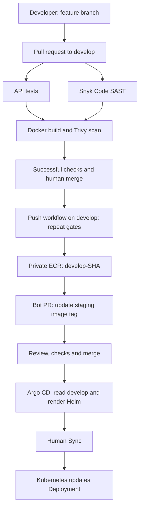
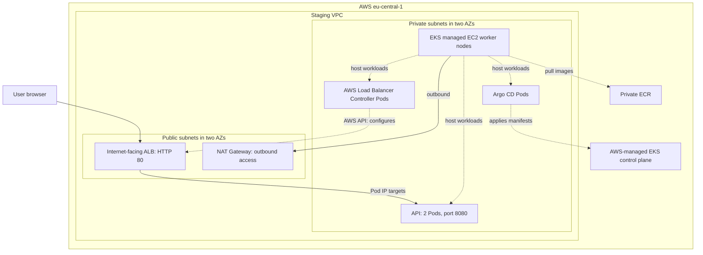

# Architecture

## Delivery flow

The feature/PR builds validate the change but do not publish to ECR. For a push changing only the staging values file, the existing image is reused and publication/tag-PR creation are skipped. The pipeline does not currently skip rebuilding/scanning that validation image.

## Runtime and AWS boundaries

This diagram shows logical placement, not EC2-level packet paths. The EKS control plane is managed by AWS; it is not a workload on the worker nodes. Its public API endpoint is restricted by the configured administrator `/32`; private endpoint access is also enabled. NAT is for outbound access and is not the application's inbound path.

The two replicas are not guaranteed to be on different nodes or AZs: the current chart has no anti-affinity or topology-spread rules. The managed node group spans private subnets, but that alone does not enforce application replica distribution.

## Who configures what?

| Component | Responsibility |
|---|---|
| Terraform | VPC, subnets, routes, NAT, EKS, worker group, IAM, access and Pod Identity |
| GitHub Actions | Test, scan, build, publish image and propose its tag through a PR |
| Helm templates | Turn chart values into Kubernetes manifests |
| Argo CD | Read Git, render Helm and apply desired resources during Sync |
| AWS Load Balancer Controller | Observe Ingress and configure AWS ALB/targets/security groups |
| Deployment / ReplicaSet | Maintain the desired application Pods and perform rollouts |
| Node kubelet/container runtime | Pull the image and run its container |

The ALB is managed by the controller, not as an `aws_lb` resource in this Terraform configuration. Controller installation is saved as a Helm command and values in the infrastructure repository; it is not yet automatically bootstrapped by Terraform.

## Three separate AWS identities

| Identity | Used by | Purpose |
|---|---|---|
| GitHub OIDC role | Develop publishing job | Push images to ECR |
| Worker node IAM role | EC2 nodes | Node operation and private ECR image pulls |
| Controller Pod Identity role | Load Balancer Controller ServiceAccount | Manage ALB-related AWS resources |

The API itself has no assigned AWS Pod Identity role. A Kubernetes ServiceAccount does not by itself grant AWS permissions.

## State and configuration ownership

- App repository: `develop`, Dockerfile, workflow, chart, staging image tag and Ingress values.
- Infra repository: `main`, Terraform, Argo CD Application and controller installation values.
- S3 backend: separate Terraform state keys for bootstrap and staging, with versioning and lockfiles.
- Kubernetes: live runtime resources, Argo CD configuration and Helm release records for installed tools.

Terraform state and credentials must not be committed. `.terraform.lock.hcl` is committed to preserve provider selections.
